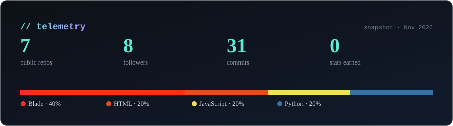

<div align="center">



<br/>

<a href="https://github.com/luc1ferxzx/luc1ferxzx-portfolio"></a>
<a href="https://www.linkedin.com/in/kyle-peralta-415036324/"></a>


</div>

<br/>

## 👾 about

> **Full Stack Power Platform Developer** at **365 Easy Ltd.** · **BSIT** at the University of Cebu (UCLM)

I build clean, practical products across **Power Platform, SharePoint, back-end systems, and visual
media**. Hackathons are where I do my best work: I compress complex systems into interfaces people
actually enjoy using, and I'm equally comfortable in a code editor or a motion timeline.

<details>
<summary><code>$ neofetch</code></summary>

```text
           ___
          /   \          kal1x@kalix
         | O O |         -----------
         |  ▼  |         Role    : Full Stack Power Platform Developer
          \_^_/          Corp    : 365 Easy Ltd.
                         Study   : BSIT @ University of Cebu (UCLM)
                         Power   : Power Apps · Power Automate · Power BI
                         SP      : SharePoint · custom development
                         Web     : PHP · Laravel · JavaScript · TypeScript · Node.js
                         Data    : Python · FastAPI · PostgreSQL · PostGIS
                         Mobile  : Flutter · Dart
                         Cloud   : Azure · AI solutions
                         Sec     : web app security · OSINT · digital forensics
                         Design  : Photoshop · Illustrator · Figma · Blender
                         Motion  : After Effects · Premiere Pro
```

</details>

---

## ⚙️ stack

<div align="center">


<br/><br/>


</div>

---

## 💼 work · 365 Easy Ltd.

- Developing and maintaining **SharePoint** sites, features, and workflows
- Building **Power Platform** solutions (Power Apps, Power Automate, Power BI), from requirements through deployment
- Working on **SharePoint custom development**, plus documentation, troubleshooting, and secure coding practice

---

## 🛰️ projects

| | Project | What it is | Stack | Repo |
| :---: | :--- | :--- | :--- | :---: |
| 🛰️ | **PHILIP** · capstone | Geospatial, AI-driven hazard intelligence with personal risk scoring and offline-first evacuation guidance | Flutter · React · Node · FastAPI · PostGIS | [↗](https://github.com/luc1ferxzx/Philip_GDRMS) |
| 🏪 | **FILGASPAND** | Pharmacy and e-commerce app: carts, orders, invoices, and role-based access (IT-ELECT2) | Laravel · Blade | [↗](https://github.com/luc1ferxzx/FILGASPAND-) |
| 🏢 | **Midterm Laravel** | Authentication, user profiles, and building management | Laravel · Blade | [↗](https://github.com/luc1ferxzx/MidtermLaravelProject) |
| 🔍 | **kavvh-ip-checker** | Lightweight Python IP checking tool | Python | [↗](https://github.com/luc1ferxzx/kavvh-ip-checker) |
| 🎨 | **KALIX portfolio** | Photo manipulation, 3D motion, apparel, and video editing | HTML · Tailwind · JS | [↗](https://github.com/luc1ferxzx/luc1ferxzx-portfolio) |

---

## 🏆 trophies

- 🥈 **2nd Place**, UCLM Hackathon
- 🎨 **Best in UI/UX**, UCLM Hackathon
- 🏅 **Hack4Gov 2025**
- 🏅 **Sinulog PropTech Hackathon**
- 🏅 **7th Place** and **Team Finalist**

---

## 📊 telemetry

<div align="center">



<br/><br/>


</div>

---

<div align="center">

<sub><code>// To Live is to Create. To Create is Reality.</code></sub>

<br/><br/>

<sub><code>kal1x@kalix:~$ exit 0</code></sub>

</div>
