<a href="https://luc1ferxzx.github.io/luc1ferxzx/"><code>$ ssh kal1x@kalix  # click to log in and type</code></a>

<pre>
KAL1X(1)                     User Commands                      KAL1X(1)

<b>NAME</b>
       kal1x - builds software, breaks software, edits the video about it

<b>SYNOPSIS</b>
       <b>kal1x</b> [<b>--sharepoint</b>] [<b>--power-platform</b>] [<b>--laravel</b>] [<b>--flutter</b>]
             [<b>--after-effects</b>] [<b>--no-sleep</b>] <i>idea</i>

<b>DESCRIPTION</b>
       Kyle Peralta. Full Stack Power Platform Developer at 365 Easy.
       BSIT at the University of Cebu (UCLM). Metro Cebu, Philippines.

       Works on SharePoint and Power Platform solutions by day. Spends the
       rest of the time on hackathons, security and motion graphics.

<b>OPTIONS</b>
       <b>--work</b>      Power Apps, Power Automate, Power BI, SharePoint, Azure
       <b>--web</b>       PHP, Laravel, JavaScript, TypeScript, Node.js, React
       <b>--data</b>      Python, FastAPI, PostgreSQL, PostGIS
       <b>--mobile</b>    Flutter
       <b>--systems</b>   C, Java, Linux
       <b>--security</b>  web app security, OSINT, forensics, crypto, reversing
       <b>--design</b>    Photoshop, Illustrator, Figma, Blender, After Effects,
                   Premiere Pro

<b>PROJECTS</b>
       <a href="https://github.com/luc1ferxzx/Philip_GDRMS"><b>philip</b></a>(1)
              Flood and landslide risk scored per person, with offline
              evacuation guidance. Capstone thesis.

       <a href="https://github.com/luc1ferxzx/FILGASPAND-"><b>filgaspand</b></a>(1)
              Pharmacy store in Laravel. Cart, checkout, invoices, admin.

       <a href="https://github.com/luc1ferxzx/kavvh-ip-checker"><b>kavvh-ip-checker</b></a>(1)
              IP address checker in Python. Class, binary form and a
              timestamped log. Team project.

       <a href="https://github.com/luc1ferxzx/MidtermLaravelProject"><b>midterm</b></a>(1)
              Building records in Laravel, behind auth.

       <a href="https://github.com/luc1ferxzx/luc1ferxzx-portfolio"><b>portfolio</b></a>(1)
              Photo editing, 3D motion, apparel and video.

<b>HISTORY</b>
       UCLM Hackathon              2nd place, Best in UI/UX
       Sinulog PropTech Hackathon  team finalist
       12th ICT Congress           hackathon award
       Hack4Gov 2025               national cybersecurity competition

<b>BUGS</b>
       None known. That is not the same as none.

<b>SEE ALSO</b>
       <a href="https://luc1ferxzx.github.io/luc1ferxzx/">shell</a>(1), <a href="https://www.linkedin.com/in/kyle-peralta-415036324/">linkedin</a>(1)

<b>NOTES</b>
       To live is to create. To create is reality.

kal1x 1.0                     November 2026                     KAL1X(1)
</pre>
